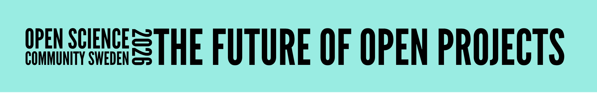

::: {.hero}

:::

# **Programme**
Below is the planned programme of the HOSSLab hackathon, the networking event, and the OSCS conference and meeting. 
  Plenary talks will be announced as they are selected.

::: {.framed-section}
## **OSCS Conference** • Tuesday December 1st

| Time | Session |
|:---:|-----------------------|
| 09:30 | Coffee - Registration Opens |
| 10:15 | Welcome by the HOSS Lab |
| 10:30 | Plenary Talks x4 |
|   11:50 | - Invited Talk -   **Managing Open, Collaborative, and Reproducible Projects**   Timothy J. Luke   <small> *Department of Psychology, University of Gothenburg* </small> |
| 12:30 | Lunch (Provided)   Universitetsklubben |
|   13:45 | - Invited Talk -   **The Future of Open Science**   Gustav Nilsonne   <small> *Department of Clinical Neuroscience, Karolinska Institutet* </small> |
|   14:30 | - Practical Session -   **Navigating Open Data: Tips, Tools, and Traps**   Lisa Hjelmfors & Kaori Hoshi Larsson   <small> University Library, Department for Research Support |
| 15:15 | Coffee Break |
| 15:45 | Annual OSCS Meeting for members |

:::

::: {.framed-section}
{alt="HOSSLab logo" fig-align="center" width="400px"}

## Hackathon:   **Managing Open Projects After OSF Changes**   Monday November 30th

On the Monday before the conference, the HOSSLab will host a hackathon titled: “Managing Open Projects After OSF Changes”. The aim of the hackathon is to prepare concise guidance for researchers. We will consider different research scenarios involving open science practices and collaboration on a smaller and larger scale. The guidance will be later available on the [HOSS webpage](https://hoss-liu.github.io/HOSS-LiU/).

#### **Hackathon information**

* Time: 15:00 - 18:00
* Location: Studenthuset, 6th floor, room SH62

<small> You can sign up for the hackathon through the conference registration link or by emailing Marta Topor at marta.topor[at]liu.se </small>

[**Sign up to the conference and hackathon**](https://forms.cloud.microsoft/e/QcaNMtq8yQ){.btn .btn-primary .btn-lg}
:::

::: {.framed-section}
## **Networking/Conference Dinner**
After the HOSSLab Hackathon (ends at around 18:00) on **Monday 30th**, we meet up at restaurant/bar *Pepa Deli* in Linköping town center.

#### **Information**

* Monday November 30th, after 18:00
* Restaurant Pepa Deli, Stora Torget 1, Linköping
* Food and drinks are at own expense
* Hackathon attendance not neccessary, everyone attending conference and/or hackathon are welcome!

<small> Restaurant website (English menu available): [pepadeli.se](https://www.pepadeli.se/) </small> 
:::